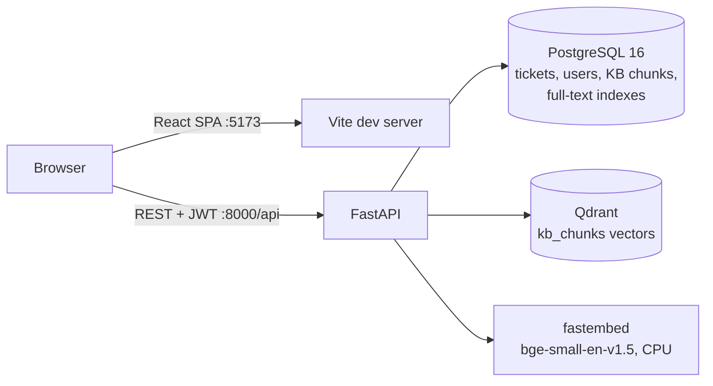

# Intell-Support

A support platform where customers raise tickets, agents resolve them through a structured
workflow, and every ticket is automatically matched against a knowledge base (KB) of PDF and TXT
documents. Matching uses **local semantic search** (a free embedding model and Qdrant), with a
**PostgreSQL full-text fallback** so suggestions keep working when the vector store or the model
is unavailable.

- **Customers** register, open tickets, follow the conversation and history, close or reopen
  resolved tickets, and search the knowledge base.
- **Agents** see every ticket, assign it, reply, add internal notes, move it through the workflow,
  use a dashboard, and manage the knowledge base (upload, reindex, delete).
- **Every new ticket** gets up to three suggested KB passages with their source (document, page,
  score). Agents can paste a passage straight into their reply.
- **No LLM and no paid APIs.** Suggestions are extracted passages, never generated text, and
  everything runs locally in Docker.

## Screenshots

See [`docs/screenshots/`](docs/screenshots/).

## Quick start

You only need **Docker Desktop**, or Docker Engine with Compose v2.

```bash
git clone https://github.com/sampnp/intell-support.git
cd intell-support
cp .env.example .env
```

Edit `.env` and set **`JWT_SECRET`** to a long random string. The backend won't start without
it. One way to make one:

```bash
python -c "import secrets; print(secrets.token_urlsafe(48))"
```

Start everything, then load the demo data:

```bash
docker compose up -d --build                                # first build downloads the model (~100 MB)
docker compose run --rm backend python -m scripts.seed      # demo users, the sample KB and tickets
```

The frontend waits for the backend's health check, so it can take up to a minute to come up the
first time.

| What | Where |
|---|---|
| Web app | http://localhost:5173 |
| API docs (Swagger) | http://localhost:8000/docs |
| Health | http://localhost:8000/api/health |

### Demo accounts

Every account's password is `demo-password` (set `SEED_PASSWORD` to change it before seeding).

| Email | Role | What the seed gives them |
|---|---|---|
| `priya@acme-demo.com` | agent | 4 active tickets assigned to her |
| `marcus@acme-demo.com` | agent | a resolved ticket and a closed one |
| `dana@acme-demo.com` | user | 4 tickets, including a reopened one |
| `sam@acme-demo.com` | user | 4 tickets, including an urgent unassigned one |

New sign-ups through the register page are always customers (role `user`). Agents only come
from the seed.

## Running the tests

```bash
# Backend: 336 tests, including one that loads the real embedding model
docker compose run --rm backend pytest -q
docker compose run --rm backend pytest -q -m "not slow"     # skip the real-model test

# Frontend: Vitest + Testing Library, then a production build as a check
docker compose run --rm --no-deps frontend npm test
docker compose run --rm --no-deps frontend npm run build
```

Backend tests run against a separate `support_test` database. Each test runs in a transaction
that is rolled back, so the demo data isn't touched. Qdrant runs in memory and a deterministic
fake embedder is used everywhere except the `slow` test.

## Everyday commands

```bash
docker compose run --rm backend python -m scripts.seed --reset   # wipe ALL data and reseed the demo
docker compose run --rm backend python -m scripts.eval_retrieval # measure retrieval quality (see below)
docker compose run --rm backend python scripts/build_sample_kb.py # regenerate the sample PDFs and bad files
docker compose logs -f backend                                    # one line per request, with request ids
docker compose up -d --build -V frontend                          # after changing frontend dependencies
docker compose down                                               # stop (add -v to delete the data volumes)
```

A plain `scripts.seed` run does nothing if the demo data already exists. `--reset` truncates
every table and recreates the Qdrant collection, including anything you created by hand.

## Architecture



| Layer | Choice |
|---|---|
| Frontend | React 18 + Vite (JavaScript), React Router, TanStack Query, Tailwind CSS |
| Backend | Python 3.12, FastAPI, Pydantic v2, SQLAlchemy 2.0 (sync), Alembic |
| Auth | JWT bearer tokens (PyJWT), bcrypt password hashes |
| Data | PostgreSQL 16 (source of truth, plus full-text search), Qdrant (vectors only) |
| Embeddings | `fastembed` with `BAAI/bge-small-en-v1.5` (384-dim, ONNX), baked into the image |

**Backend layers** (`backend/app/`): `api/` has thin routers. `services/` has the business rules:
tickets, workflow, ingestion, chunking, retrieval, suggestions and the dashboard. `core/` has
security, the auth dependencies, permissions in one place, and errors and logging. `models/` and
`schemas/` hold the SQLAlchemy and Pydantic models. Every error uses one envelope:
`{"error": {"code", "message", "details"}}`.

### Data model

| Table | Holds |
|---|---|
| `users` | email (lowercased, unique), name, bcrypt hash, role `user` or `agent` |
| `tickets` | title, description, category, priority, status, creator, assignee, generated full-text vector, suggestions mode and time |
| `ticket_comments` | public replies and internal notes |
| `ticket_events` | append-only history (a database trigger rejects UPDATE and DELETE) |
| `documents` | uploaded KB files: status `processing`, `ready` or `failed`, error, chunk count, `vector_indexed` |
| `document_chunks` | passages (UUID ids shared with Qdrant), page number, generated full-text vector |
| `ticket_suggestions` | the ranked snapshot of passages suggested for a ticket |

### Ticket workflow

| From | To | Who |
|---|---|---|
| open | in_progress, resolved | agent |
| in_progress | waiting_for_user, resolved | agent |
| waiting_for_user | in_progress, resolved | agent; also **automatic** when the owner replies |
| resolved | closed | owner or agent |
| resolved | open (reopen) | owner |
| closed | nothing | terminal |

The transition table lives in one place (`services/workflow.py`). Every ticket response includes
`allowed_transitions` for the current user, so the UI only shows valid buttons. Anything else
gets **409** with the allowed list. Every change writes a history event in the same transaction.

### Knowledge base pipeline

1. **Upload** (agents): the extension must be `.pdf` or `.txt` and the file at most
   `MAX_UPLOAD_MB`. PDFs must start with `%PDF`, and TXT must be non-empty UTF-8. A file that
   fails these checks is rejected immediately (400/413/415) and nothing is stored. Otherwise the
   response is **202** with status `processing`.
2. **Background processing:**
   1. Text is extracted page by page (TXT counts as one page). A scanned, image-only or corrupt
      PDF ends `failed` with a readable reason.
   2. The text is split into paragraph-aware passages of about 800 characters, overlapping by
      about 150, never crossing a page.
   3. The passages are stored in Postgres, which builds the full-text index.
   4. They're embedded and upserted into Qdrant. If that step fails, the document is still
      `ready` with `vector_indexed=false`; keyword search works, and **Reindex** fixes it later.
3. **Delete** removes the document from both stores. It also removes any ticket suggestions that
   pointed at its passages.

### Retrieval

- **`auto` (the default):** semantic search first. The question is embedded and Qdrant returns
  the nearest passages, which are joined back to Postgres (`ready` documents only) and filtered
  by `RETRIEVAL_SCORE_THRESHOLD`. If the model or Qdrant raises *any* error, it logs a warning
  and falls back to keyword search.
- **`keyword`:** Postgres full-text search, using all query words first
  (`websearch_to_tsquery`). If that finds nothing, it retries with *any* word, ranked by
  `ts_rank_cd`, because a whole ticket description rarely has every word in one passage.
- **`semantic`:** semantic only. If it can't run, the response is **503** rather than a silent
  fallback.
- **`insufficient: true`** when nothing is left. The response always says which `mode` was used.

**Suggestions** run on ticket creation, with the query `title + "\n" + description` and k=3. The
result is stored as a snapshot, and the ticket records the mode and time, so an empty snapshot
still says what happened. **Refresh** re-runs it. If retrieval fails entirely, ticket creation
still succeeds with an empty snapshot.

## Retrieval threshold

`RETRIEVAL_SCORE_THRESHOLD` (cosine similarity) decides when the app says *"not enough
information"* instead of showing a weak match. The default is **0.6**, chosen with
`scripts/eval_retrieval.py`:
- 12 customer-style questions, two per sample document, phrased in the customer's own words
  rather than copied from the text
- 4 off-topic questions the KB can't answer, such as banana bread or changing a car's oil

Measured on the seeded sample KB with the real model:

| Mode | hit@3 | MRR@10 |
|---|---|---|
| semantic | 0.92 | 0.93 |
| keyword (fallback) | 0.92 | 0.89 |

| | Top-1 semantic scores |
|---|---|
| Relevant questions | 0.654 – 0.857 (0.690 – 0.857 where the right document ranked first) |
| Off-topic questions | 0.370, 0.408, 0.481, 0.536 |

| Threshold | Relevant answered | Off-topic wrongly answered |
|---|---|---|
| 0.50 | 12/12 | 1/4 (the car oil question, 0.536) |
| 0.55 | 12/12 | 0/4 |
| **0.60** | **12/12** | **0/4** |
| 0.65 | 12/12 | 0/4 |
| 0.70 | 8/12 | 0/4 |

0.6 sits in the middle of the range that answers everything relevant and nothing off-topic.
That leaves a margin both ways on a set this small.

- **To change it,** set `RETRIEVAL_SCORE_THRESHOLD` in `.env` and restart the backend. An `.env`
  copied from an older `.env.example` may still say `0.5`.
- **To re-check after changing the KB or the model,** run
  `docker compose run --rm backend python -m scripts.eval_retrieval`, which prints this sweep.
- The threshold applies to semantic scores only. Keyword ranks use a different scale, so keyword
  results are never cut by it.

## API reference

All paths are under `/api`, and the live, try-it-out docs are at
http://localhost:8000/docs. Authenticated calls send `Authorization: Bearer <token>`.

| Method | Path | Who | Notes |
|---|---|---|---|
| POST | `/auth/register` | anyone | `{email, full_name, password}` (8–72 bytes). Returns `{access_token, token_type, user}`; always role `user` |
| POST | `/auth/login` | anyone | `{email, password}`. Same response as register |
| GET | `/auth/me` | signed in | the current user |
| POST | `/tickets` | signed in | `{title, description, category, priority?}`. Creates the ticket, its event and its suggestions |
| GET | `/tickets` | signed in | `q, status, priority, category, assigned=me\|unassigned, page, page_size`. Users only see their own |
| GET | `/tickets/{id}` | owner or agent | includes `allowed_transitions` |
| PATCH | `/tickets/{id}` | owner, while `open` | `{title?, description?}` |
| POST | `/tickets/{id}/status` | per workflow | `{status}`. 409 lists the allowed moves |
| POST | `/tickets/{id}/assign` | agent | `{agent_id}`, or `null` to unassign. The assignee must be an agent |
| GET / POST | `/tickets/{id}/comments` | owner or agent | `{body, is_internal}`. Internal notes are agent-only and never returned to users |
| GET | `/tickets/{id}/events` | owner or agent | history. Internal-note events are hidden from users |
| GET | `/tickets/{id}/suggestions` | owner or agent | the stored snapshot: `{mode, insufficient, updated_at, results}` |
| POST | `/tickets/{id}/suggestions/refresh` | owner or agent | re-runs retrieval and replaces the snapshot |
| GET | `/dashboard/agent` | agent | counts (my open, unassigned, waiting, urgent), plus "My queue" and "Unassigned" |
| GET | `/users/agents` | agent | for the assignment dropdown |
| POST | `/kb/documents` | agent | multipart `file`, optional `title`. Returns 202 with `processing` |
| GET | `/kb/documents` | agent | newest first |
| GET | `/kb/documents/{id}` | agent | status, error, chunks, `vector_indexed` |
| DELETE | `/kb/documents/{id}` | agent | removes it from Postgres and Qdrant |
| POST | `/kb/documents/{id}/reindex` | agent | re-embeds into Qdrant (503 if unavailable) |
| GET | `/kb/search` | signed in | `q`, `k` (1–10, default 3), `mode=auto\|semantic\|keyword` |
| GET | `/health` | anyone | `{status, db, qdrant, embedder}`. Always 200; `degraded` if something is down |

Search and suggestion results look like this:

```json
{"mode": "semantic", "insufficient": false,
 "results": [{"chunk_id": "…", "document_id": 3, "document_title": "billing-refund-policy",
              "page": 2, "snippet": "…", "score": 0.78}]}
```

Errors look like `{"error": {"code": "TICKET_NOT_FOUND", "message": "Ticket not found",
"details": null}}`. The status codes:

| Code | Meaning |
|---|---|
| 401 | missing, invalid or expired token |
| 403 | wrong role, for example `AGENT_REQUIRED` or `INTERNAL_NOTE_FORBIDDEN` |
| 404 | not found, **including someone else's ticket** |
| 409 | invalid transition, closed ticket, unchanged assignment, document not ready |
| 413 / 415 / 400 | upload rejected |
| 422 | validation errors, with per-field `details` |
| 503 | semantic search or reindex unavailable |

Unexpected errors return 500 with a `request_id` and no stack trace.

## Key decisions

- **No LLM; extractive suggestions with sources.** Answers can be traced to a document and page,
  nothing is made up, and there's no paid API.
- **Postgres is the source of truth, and Qdrant is only an index.** Search results are always
  joined back to Postgres, so a stale or orphaned vector can never show a deleted document.
- **Semantic first, with a keyword fallback.** The app keeps answering when the model or Qdrant
  is down, and every response states the mode actually used.
- **All words first, then any word, in keyword search.** All-words matching almost never matches
  a full ticket description. A test caught this during WP6.
- **An explicit `mode=semantic` returns 503** instead of silently using keywords. Only `auto`
  falls back.
- **The threshold is measured, not guessed** (see above).
- **A suggestion snapshot is stored per ticket,** with its mode and time on the ticket. The page
  shows what the agent saw, and an empty snapshot still explains itself.
- **Ticket creation never fails because of retrieval.**
- **Someone else's ticket returns 404, not 403,** so ticket ids can't be probed.
- **Append-only history** is enforced by a database trigger, not just by convention.
- **Permissions live in one module** (`core/permissions.py`), and the frontend only hides what the
  API already forbids.
- **The KB document list is agent-only.** Users get passages and sources through search and
  suggestions.
- **The seed is repeatable:** a plain run skips if the data is there, and `--reset` rebuilds the
  demo.
- **A backend health check in Compose.** The frontend starts only once the API really answers,
  because uvicorn's `--reload` opens the port before the app is ready.
- **The JWT is stored in `localStorage`** (per the plan). Any 401 logs out and sends you to login.

## Known limitations

- **Development setup only.** The Vite dev server and `uvicorn --reload` aren't production
  servers, and there's no TLS, rate limiting or token revocation.
- **The JWT in `localStorage` can be read by any script on the page** (an XSS risk). An httpOnly
  cookie would be safer for production.
- **`npm audit` reports 12 advisories** (5 moderate, 5 high, 2 critical) against the pinned
  frontend dependencies. They haven't been reviewed or upgraded yet. Run
  `docker compose run --rm --no-deps frontend npm audit` for the details.
- **The threshold was tuned on a small set:** 6 documents, 12 relevant and 4 off-topic questions.
  Re-run the evaluation when the KB grows.
- **Full-text search uses the English configuration only.**
- **There's no ticket-edit screen** (the API supports it), and **no Playwright end-to-end tests**
  (a stretch goal in the plan).

## Project layout

```
backend/            FastAPI app (app/), Alembic migrations, tests/, scripts/ (seed, eval, sample KB)
frontend/           React + Vite app (src/api, context, components, features, pages, lib)
sample_kb/          Acme Cloud documents, plus malformed/ files used by the tests
docker/             Postgres init script (creates the test database)
docs/PLAN.md        the specification and work packages
docs/CODEZERO_NOTES.md   how CodeZero was used, package by package
docs/codezero/plans/     the approved plan for each work package
docker-compose.yml  postgres, qdrant, backend, frontend
```

This project was built in work packages with **CodeZero** (Frigga's VS Code extension), each one
going through a reviewed plan, tasks, tests and commit. See
[`docs/CODEZERO_NOTES.md`](docs/CODEZERO_NOTES.md) and [`docs/PLAN.md`](docs/PLAN.md).
